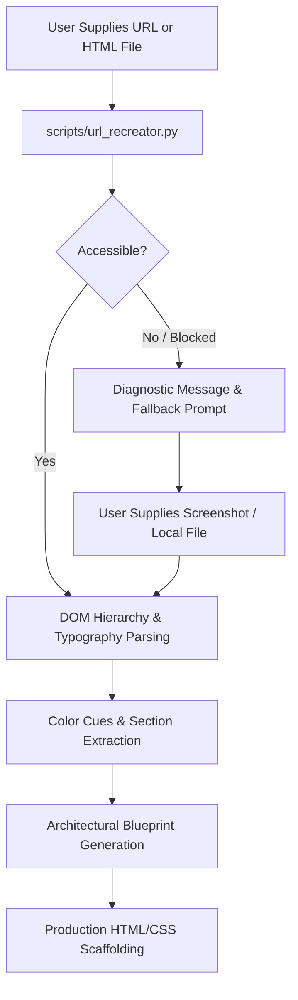

# Website Recreation Workflow Reference
**Author: ScraperDev BD** (https://www.scraperdevbd.fun/)

Ultra UI/UX Pro Max provides a reference-driven workflow for analyzing and recreating public websites, design mockups, and supplied HTML documents into clean, production-ready, accessible source code.

---

## 1. Recreation Principles & Ethics

1. **Original Implementation**: Never scrape private data or mirror proprietary assets without authorization. Extract design principles, typography hierarchies, spatial rhythm, and component structures, then synthesize an original, clean implementation.
2. **Accessible by Default**: Recreated pages automatically enforce WCAG 2.2 AA contrast ratios, semantic HTML landmarks, responsive viewports, and keyboard `:focus-visible` states.
3. **Graceful Degradation**: If an external URL blocks automated requests (HTTP 403, Cloudflare, timeout), the skill provides fallback options:
   - Screenshot-based visual replication.
   - User-supplied HTML/CSS files.
   - Requirement-guided reconstruction using matched design presets.

---

## 2. Analysis Phases



### Inspected Dimensions:
- **Title & Metadata**: Title, OpenGraph image, meta description.
- **Headings Structure**: H1 through H6 hierarchy and text content.
- **Typography Links**: Web font links (Google Fonts, Adobe Fonts, custom typefaces).
- **Navigation & Links**: Navigation menus, header links, and footer structures.
- **Call-to-Action Buttons**: Button text, primary vs secondary buttons.
- **Forms & Inputs**: Form presence, input types, and submission triggers.
- **Layout Containers**: Header, Hero, Bento grid, Feature cards, Footer.
- **Color Extraction**: Hex codes extracted from inline styles and stylesheets.

---

## 3. Running the Recreation Tool

### Analyze a Public Website
```bash
python scripts/url_recreator.py "https://example.com"
```

### Analyze a Local HTML File
```bash
python scripts/url_recreator.py "path/to/page.html"
```

### Directly Generate Modern Responsive Scaffold Code
```bash
python scripts/url_recreator.py "https://example.com" --scaffold --output "scaffold.html"
```
